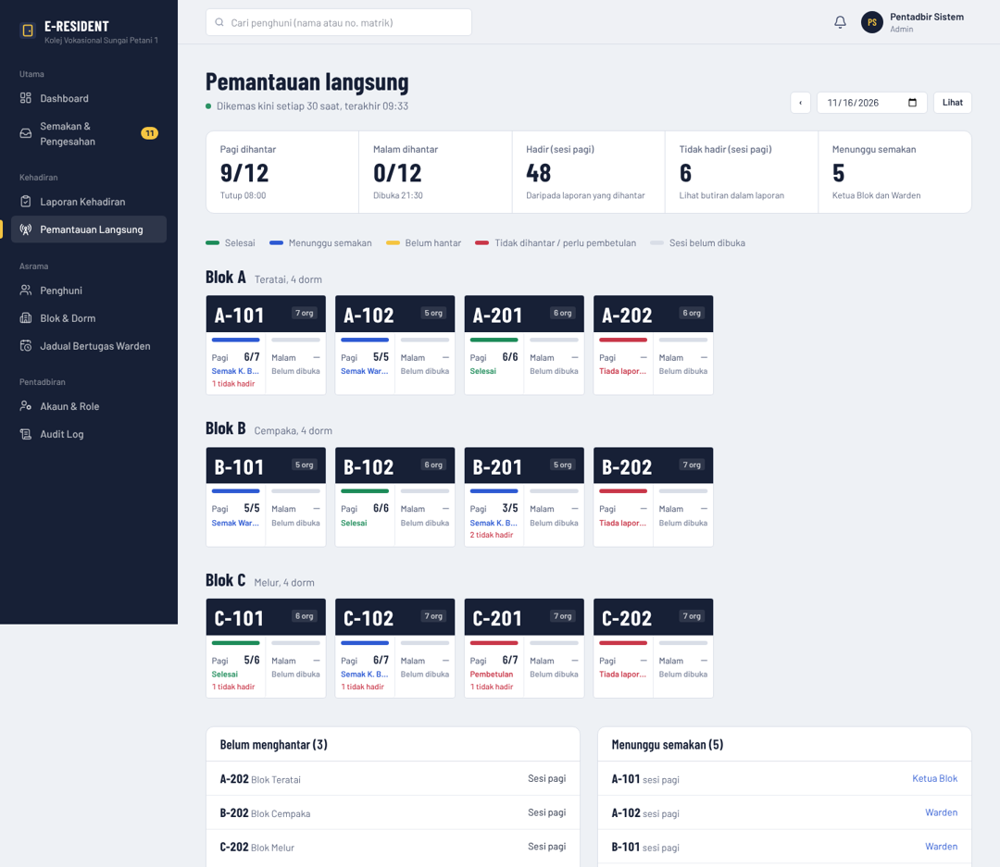
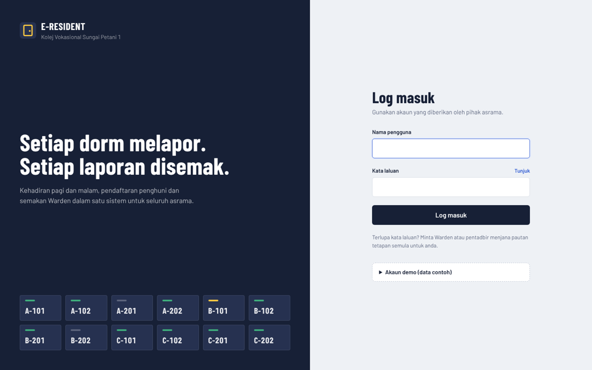
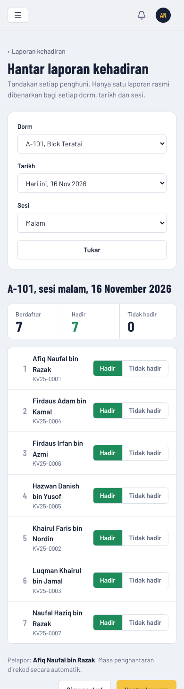

# E-RESIDENT

**Electronic Residential Management System**, iaitu sistem pengurusan asrama digital untuk kehadiran pagi dan malam, pendaftaran penghuni, semakan berperingkat (Ketua Dorm → Ketua Blok → Warden) dan pemantauan langsung seluruh asrama.



| Log masuk | Hantar laporan (telefon) |
|---|---|
|  |  |

> Semua nama, nombor matrik dan nombor telefon dalam data contoh adalah **rekaan**.

---

## Kandungan

1. [Ciri yang sudah berfungsi](#ciri-yang-sudah-berfungsi)
2. [Cara paling mudah: GitHub Codespaces](#cara-paling-mudah-github-codespaces)
3. [Jalankan di komputer sendiri](#jalankan-di-komputer-sendiri)
4. [Akaun demo](#akaun-demo)
5. [Cuba aliran kerja penuh](#cuba-aliran-kerja-penuh)
6. [Struktur projek](#struktur-projek)
7. [Deployment production](#deployment-production)
8. [Keselamatan](#keselamatan)
9. [Fasa seterusnya](#fasa-seterusnya)

Dokumen analisis Fasa 1 (seni bina, skema, permission matrix 10 role, flowchart, perkara untuk disahkan): **[docs/FASA-1-ANALISIS.md](docs/FASA-1-ANALISIS.md)**

---

## Ciri yang sudah berfungsi

| Modul | Fungsi |
|---|---|
| **Log masuk & sesi** | Sesi selamat dalam pangkalan data, rate limiting, log keluar, senarai & tamatkan sesi aktif, tukar kata laluan |
| **10 role + RBAC** | Kebenaran disemak di server bagi setiap halaman & tindakan; skop data mengikut blok/dorm; kebenaran tambahan untuk role Penolong |
| **Dashboard ikut role** | Admin/Ketua Warden/Warden, Ketua Blok, Ketua Dorm, Ketua Asrama (agregat sahaja), Penghuni |
| **Laporan kehadiran pagi & malam** | Senarai semak setiap penghuni, sebab tidak hadir wajib, draf, satu laporan rasmi bagi setiap dorm/tarikh/sesi, jumlah dikira automatik |
| **Aliran semakan** | Ketua Blok → Warden, kembalikan untuk pembetulan, pindaan direkod (sebelum/selepas), jejak semakan penuh |
| **Pemantauan langsung** | Papan semua dorm (pagi & malam), muat semula setiap 30 saat, dorm belum hantar, laporan menunggu semakan, sejarah ikut tarikh |
| **Semakan & pengesahan** | Satu halaman untuk semua item yang menunggu tindakan anda |
| **Penghuni** | Carian, penapis, paginasi, daftar, edit, pindah dorm/blok, nyahaktif (tanpa padam), sejarah perubahan |
| **Pendaftaran penghuni + akaun** | Ketua Dorm → Ketua Blok → Warden → pautan pengaktifan sekali guna → penghuni tetapkan kata laluan sendiri |
| **Blok & dorm** | Tambah/edit, kapasiti, tetapkan Ketua/Penolong Blok & Dorm, tetapkan Warden bertanggungjawab |
| **Jadual bertugas Warden** | Paparan mingguan, tambah/edit/padam giliran, semakan pertindihan |
| **Akaun & role** | Cipta akaun, tukar role, aktif/nyahaktif, jana pautan reset, kebenaran tambahan, permission matrix |
| **Audit log** | Rekod log masuk, tambah, edit, kelulusan, penolakan, pindaan, perubahan role; baca sahaja |
| **Notifikasi** | Dalam aplikasi, dihantar automatik pada setiap peringkat aliran kerja |

---

## Cara paling mudah: GitHub Codespaces

> **Nota:** GitHub Pages **tidak boleh** menjalankan sistem ini kerana Pages hanya untuk laman statik. E-RESIDENT memerlukan server Node.js dan pangkalan data MySQL. Codespaces menyediakan kedua-duanya secara percuma dalam pelayar.

1. Muat naik folder projek ini ke repositori GitHub baharu (lihat [Muat naik ke GitHub](#muat-naik-ke-github)).
2. Dalam repositori, klik **Code → Codespaces → Create codespace on main**.
3. Tunggu 3 hingga 5 minit. Skrip `scripts/codespaces-setup.sh` akan memasang pakej, menyediakan MySQL, menjalankan migrasi dan memuatkan data contoh secara automatik.
4. Dalam terminal Codespaces, taip:
   ```bash
   npm run dev
   ```
5. Klik **Open in Browser** apabila port 3000 muncul. Log masuk dengan `admin` / `Demo@1234`.

### Muat naik ke GitHub

```bash
cd e-resident
git init
git add .
git commit -m "E-RESIDENT: Fasa 1 hingga 5"
git branch -M main
git remote add origin https://github.com/NAMA-ANDA/e-resident.git
git push -u origin main
```

Setiap kali anda push, **GitHub Actions** (`.github/workflows/ci.yml`) akan menjalankan migrasi, seed, build dan typecheck dengan MySQL sebenar. Lihat tab **Actions** untuk keputusan.

---

## Jalankan di komputer sendiri

**Keperluan:** Node.js 20 atau lebih baharu, dan sama ada Docker Desktop **atau** MySQL 8 yang dipasang sendiri (contoh XAMPP/Laragon dengan MySQL 8).

```bash
# 1. Pasang pakej
npm install

# 2. Sediakan fail persekitaran
cp .env.example .env        # Windows: copy .env.example .env

# 3. Hidupkan MySQL (jika guna Docker)
docker compose up -d
#    Jika guna MySQL sendiri: cipta pangkalan data "eresident" dan kemas kini DATABASE_URL dalam .env

# 4. Cipta jadual & masukkan data contoh
npm run setup

# 5. Jalankan
npm run dev
```

Buka http://localhost:3000

| Arahan | Fungsi |
|---|---|
| `npm run dev` | Pelayan pembangunan |
| `npm run setup` | Migrasi + data contoh (pemasangan pertama) |
| `npm run db:seed` | Kosongkan & muat semula data contoh (pembangunan sahaja) |
| `npm run db:migrate` | Cipta migrasi baharu selepas mengubah `prisma/schema.prisma` |
| `npm run build` / `npm start` | Build & jalankan versi production |
| `npm run bootstrap` | Persediaan production: role, permission, tetapan & Admin pertama |
| `npm run typecheck` | Semakan jenis TypeScript |

---

## Akaun demo

Kata laluan semua akaun: **`Demo@1234`**

| Nama pengguna | Role | Skop |
|---|---|---|
| `admin` | Admin | Seluruh sistem |
| `ketuawarden` | Ketua Warden | Seluruh sistem (setara Admin) |
| `warden1` | Warden | Blok A & B |
| `warden2` | Warden | Blok C |
| `ketuaasrama` | Ketua Asrama | Statistik agregat |
| `kb.a`, `kb.b`, `kb.c` | Ketua Blok | Blok masing-masing |
| `pkb.a` | Penolong Ketua Blok A | Diberi kuasa menyemak kehadiran |
| `kd.a101` (dan `kd.b202`, `kd.c101`, …) | Ketua Dorm | Dorm masing-masing |
| `pkd.a101` | Penolong Ketua Dorm A-101 | Diberi kuasa menghantar laporan |
| `pelajar` | Penghuni | Profil sendiri |

### Portal & pendaftaran pelajar

| Halaman | Untuk | Cara log masuk |
|---|---|---|
| `/` | Semua | Laman utama dengan butang **Get Started** dan butang **Portal Admin** yang berasingan |
| `/login` | Pelajar & staf asrama | Pelajar: no. IC (12 digit) + 4 digit terakhir IC. Staf: nama pengguna + kata laluan |
| `/daftar` | Pelajar baharu | Daftar dengan nama, no. IC dan telefon. Akaun aktif serta-merta |
| `/admin-login` | Admin & Ketua Warden sahaja | Akaun akses penuh ditolak di `/login` dan mesti guna portal ini |
| `/pelajar` | Admin | Senarai pelajar yang mendaftar sendiri: aktif/nyahaktif, reset kata laluan, padam |

Cipta atau tukar kata laluan akaun admin khas:

```bash
npx tsx scripts/create-admin.ts --username adminkvsp1 --password "KataLaluanKuat123" --name "Pentadbir KVSP1"
```

> **Nota keselamatan:** kata laluan 4 digit terakhir IC mudah diteka oleh sesiapa yang tahu no. IC pelajar. Had cubaan log masuk (5 kali / 15 minit) membantu, tetapi galakkan pelajar menukar kata laluan di halaman Profil.

---

## Cuba aliran kerja penuh

1. Log masuk `kd.a101` → **Hantar laporan** → tandakan seorang *Tidak hadir* dengan sebab → **Hantar laporan**.
2. Log masuk `kb.a` → **Semakan & Pengesahan** → buka laporan → **Kembalikan untuk pembetulan** dengan catatan.
3. Log masuk `kd.a101` → buka laporan → **Betulkan & hantar semula** (pindaan direkod).
4. Log masuk `pkb.a` (atau `kb.a`) → **Luluskan**.
5. Log masuk `warden1` → **Luluskan** → status *Selesai*. Lihat **Jejak semakan** dan **Audit Log** (`admin`).
6. Pendaftaran: `kd.a101` → **Penghuni → Daftar penghuni** → `kb.a` luluskan → `warden1` **Sahkan & aktifkan** → salin pautan pengaktifan → buka dalam tetingkap inkognito → tetapkan kata laluan → log masuk dengan no. matrik (huruf kecil).
7. Buka **Pemantauan Langsung** sebagai `admin` untuk melihat papan semua dorm.

Ujian yang telah dijalankan semasa pembangunan: semua halaman untuk setiap role (akses dibenarkan/disekat mengikut matriks), aliran kehadiran lengkap termasuk pembetulan dan pindaan, sekatan laporan berganda, sekatan akses ke dorm/blok lain, pendaftaran hingga pengaktifan akaun, pautan sekali guna, no. matrik berganda, rate limiting log masuk, dan build production.

---

## Struktur projek

```
e-resident/
├─ prisma/
│  ├─ schema.prisma          # 25 model: pengguna, role, kehadiran, penghuni, audit, …
│  ├─ migrations/            # Migrasi SQL berversi
│  └─ seed.ts                # Data contoh palsu
├─ src/
│  ├─ middleware.ts          # Halang laluan tanpa sesi
│  ├─ lib/
│  │  ├─ permissions.ts      # Permission matrix (sumber tunggal)
│  │  ├─ auth.ts             # Sesi, kebenaran, skop blok/dorm
│  │  ├─ action.ts           # Pembalut server action (auth + validasi + ralat)
│  │  ├─ audit.ts            # Audit log & notifikasi
│  │  ├─ queue.ts            # Item menunggu tindakan
│  │  └─ monitor.ts, stats.ts, dates.ts, labels.ts, account.ts
│  ├─ components/            # UI: shell, borang, papan dorm, carta, jejak semakan
│  └─ app/
│     ├─ login/, kata-laluan/[token]/
│     └─ (app)/              # Halaman selepas log masuk
│        ├─ dashboard/  semakan/  kehadiran/  pemantauan/
│        ├─ penghuni/  pendaftaran/  blok/  dorm/  jadual/
│        └─ akaun/  audit/  profil/  notifikasi/
├─ docs/FASA-1-ANALISIS.md
├─ docker-compose.yml        # MySQL tempatan
├─ .devcontainer/            # GitHub Codespaces
└─ .github/workflows/ci.yml  # Ujian build automatik
```

---

## Deployment production

### Pilihan A: Vercel + MySQL terurus (paling mudah)

1. Sediakan MySQL 8 terurus (contoh: Aiven, TiDB Cloud, Railway, DigitalOcean). Dapatkan `DATABASE_URL`.
2. Import repositori di [vercel.com](https://vercel.com) → tetapkan pembolehubah persekitaran:
   - `DATABASE_URL`
   - `APP_URL` = URL sebenar, contoh `https://asrama.contoh.edu.my`
   - `SESSION_TTL_HOURS` = `8`
3. Build command: `npx prisma migrate deploy && npm run build`
4. **Jangan** jalankan seed demo di production. Cipta akaun Admin pertama dengan `npm run bootstrap` (lihat di bawah).

### Pilihan B: VPS / server sekolah (Ubuntu)

```bash
# Node.js 22 + MySQL 8 dipasang terlebih dahulu
git clone https://github.com/NAMA-ANDA/e-resident.git && cd e-resident
npm ci
cp .env.example .env && nano .env      # isi DATABASE_URL & APP_URL sebenar
npx prisma migrate deploy
npm run bootstrap -- --admin pentadbir --name "Nama Pentadbir"
npm run build
npx pm2 start npm --name e-resident -- start
```
Letakkan Nginx/Caddy di hadapan dengan HTTPS (contoh Let's Encrypt). Cookie sesi ditanda `Secure` dalam production, jadi HTTPS adalah wajib.

### Akaun Admin pertama di production

Seed demo **tidak boleh** digunakan di production. Gunakan `bootstrap`, yang selamat dijalankan berulang kali dan tidak memasukkan data contoh:

```bash
npx prisma migrate deploy
npm run bootstrap -- --admin pentadbir --name "Nama Pentadbir"
```
Skrip ini menyegerakkan 10 role dan permission matrix, mencipta tetapan asas, kemudian mencetak pautan pengaktifan sekali guna untuk Admin pertama. Jalankan `npm run bootstrap` semula (tanpa `--admin`) setiap kali `src/lib/permissions.ts` diubah.

### Pembolehubah persekitaran

| Nama | Wajib | Keterangan |
|---|---|---|
| `DATABASE_URL` | Ya | Sambungan MySQL |
| `APP_URL` | Ya | URL awam, untuk pautan pengaktifan/reset |
| `SESSION_TTL_HOURS` | Tidak | Default 8 |
| `ALLOWED_ORIGINS` | Tidak | Domain tambahan untuk Server Actions di belakang proxy |
| `SHOW_DEMO_LOGINS` | Tidak | `1` untuk papar akaun demo di production (demo sahaja) |

### Sandaran pangkalan data

```bash
# Sandaran harian (contoh cron 2:00 pagi)
mysqldump --single-transaction --routines -u USER -p eresident | gzip > eresident-$(date +%F).sql.gz

# Pulihkan
gunzip < eresident-2026-11-16.sql.gz | mysql -u USER -p eresident
```
Simpan sekurang-kurangnya 14 salinan harian di lokasi berasingan daripada server.

---

## Keselamatan

- Kata laluan: bcrypt (kos 12). Tiada kata laluan plaintext di mana-mana.
- Sesi: token rawak 256-bit dalam cookie `httpOnly`, `SameSite=Lax`, `Secure` (production); hanya hash disimpan dalam DB.
- RBAC + skop blok/dorm disemak di server, bukan hanya menyembunyikan butang.
- Validasi input dengan Zod pada setiap tindakan.
- Prisma (parameterized query) menghalang SQL injection; React melarikan output (XSS).
- Server Actions menyemak `Origin` (CSRF).
- Rate limiting log masuk; pautan pengaktifan/reset sekali guna dan tamat tempoh.
- Audit log hanya boleh ditambah.
- Header keselamatan: `X-Frame-Options`, `X-Content-Type-Options`, `Referrer-Policy`, `Permissions-Policy`.

---

## Fasa seterusnya

Fasa 6 (model pangkalan data sudah tersedia): carta organisasi, direktori Warden, pengumuman bersasar, aduan & kerosakan, pemeriksaan kebersihan, rekod disiplin (sulit), laporan & eksport PDF/Excel, tetapan sistem.

Sebelum Fasa 6, sila semak bahagian **"Percanggahan dan perkara yang perlu disahkan"** dalam [docs/FASA-1-ANALISIS.md](docs/FASA-1-ANALISIS.md).
