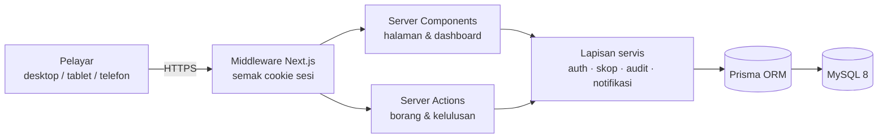
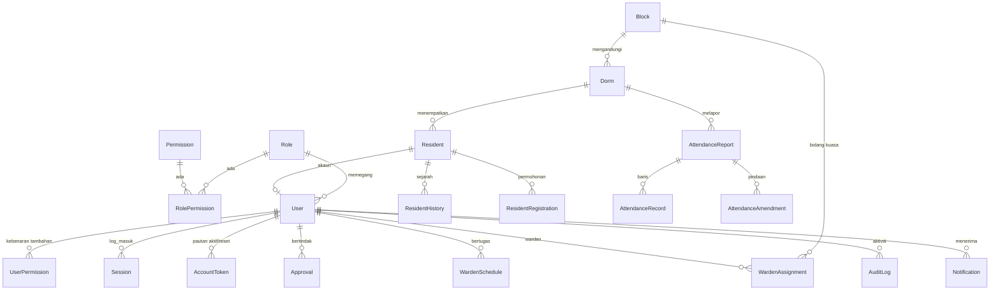
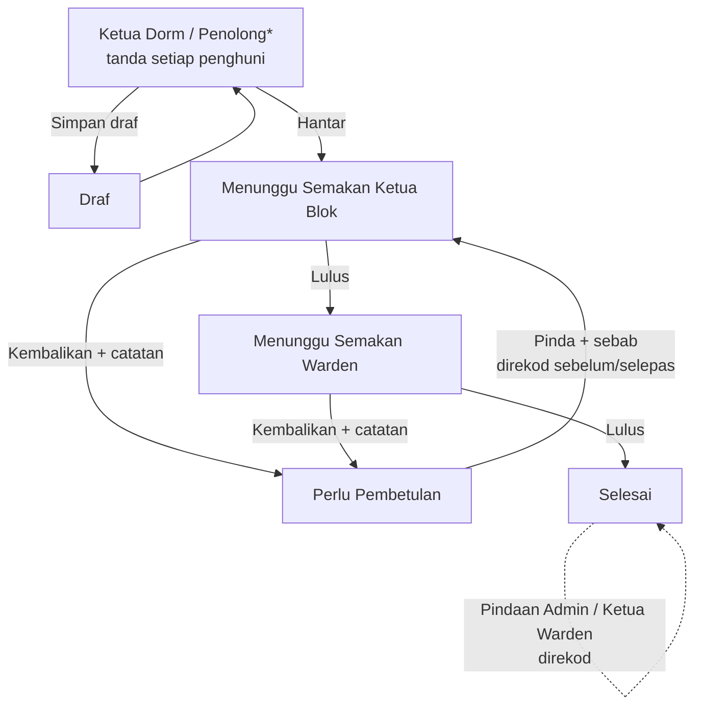
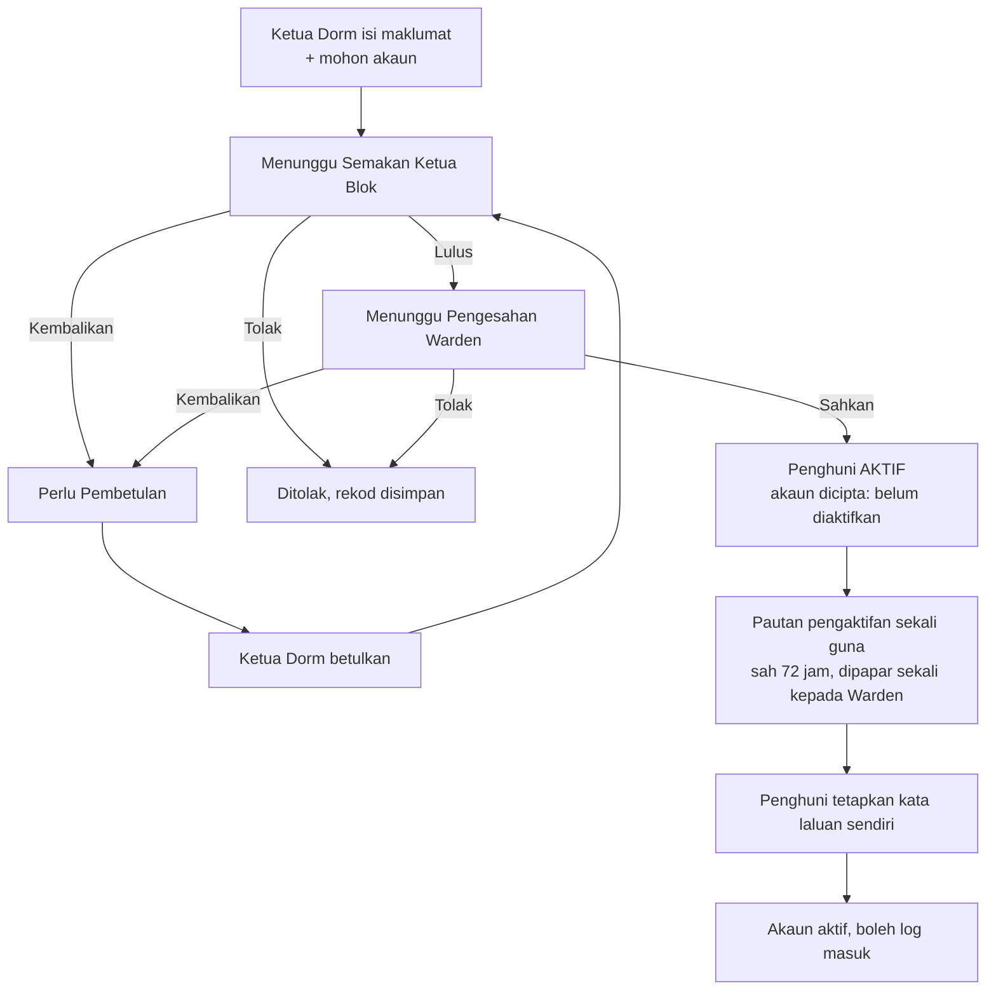
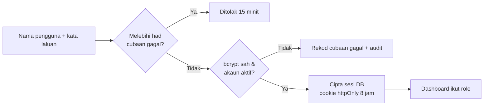

# Fasa 1: Analisis dan Perancangan E-RESIDENT

Dokumen ini merekodkan seni bina, reka bentuk pangkalan data, permission matrix, aliran kerja utama dan perkara yang perlu disahkan sebelum fasa seterusnya.

## 1. Seni bina sistem

| Lapisan | Teknologi | Peranan |
|---|---|---|
| Frontend | Next.js 15 (App Router), TypeScript, Tailwind CSS 4 | Halaman dirender di server; hanya komponen interaktif dihantar sebagai JavaScript |
| Backend | Server Actions & Route Handlers | Semua penulisan data melalui `guarded()` yang menyemak sesi, kebenaran dan validasi Zod |
| Pangkalan data | MySQL 8 + Prisma 6 | Kunci asing, kekangan unik, indeks, migrasi berversi |
| Auth | Sesi dalam pangkalan data + cookie `httpOnly` | Token rawak 256-bit, hanya hash SHA-256 disimpan; kata laluan bcrypt (kos 12) |
| Carta | Recharts | Kadar kehadiran 7 hari |

**Kenapa sesi pangkalan data dan bukan JWT?** Sesi boleh ditamatkan serta-merta (log keluar, nyahaktif akaun, tukar role, tukar kata laluan), dan senarai sesi aktif boleh dipaparkan kepada pengguna. Ini sukar dilakukan dengan JWT tanpa senarai hitam.

**Lapisan keselamatan**

- Middleware hanya lapisan pertama (menghalang laluan tanpa cookie). Pengesahan sebenar dibuat dalam `src/lib/auth.ts` pada setiap halaman dan tindakan.
- Kebenaran = permission role + kebenaran tambahan individu (`UserPermission`).
- Skop data: Admin/Ketua Warden semua; Warden ikut blok yang ditetapkan; Ketua/Penolong Ketua Blok ikut blok sendiri; Ketua/Penolong Ketua Dorm ikut dorm sendiri.
- CSRF: Server Actions Next.js hanya menerima POST dan menyemak `Origin` berbanding `Host`. Cookie `SameSite=Lax`.
- XSS: React melarikan semua output; tiada `dangerouslySetInnerHTML`.
- SQL injection: semua pertanyaan melalui Prisma (parameterized).
- Rate limiting: 5 cubaan log masuk gagal bagi setiap nama pengguna, 20 bagi setiap IP, dalam 15 minit.
- Header: `X-Frame-Options: DENY`, `nosniff`, `Referrer-Policy`, `Permissions-Policy`.

## 2. Pangkalan data

Semua model dalam `prisma/schema.prisma`. Ringkasan hubungan utama:

Keputusan reka bentuk penting:

| Keperluan | Pelaksanaan |
|---|---|
| Satu laporan rasmi bagi setiap dorm, tarikh, sesi | `@@unique([dormId, date, session])` pada `AttendanceReport` |
| Jumlah hadir + tidak hadir = berdaftar | Jumlah dikira di server daripada `AttendanceRecord` (satu baris setiap penghuni aktif), bukan diisi pengguna |
| Pembetulan direkodkan | `AttendanceAmendment` menyimpan nilai sebelum & selepas, sebab, pengguna dan masa |
| Nama penyemak, tarikh, masa, catatan | `Approval` generik (`entityType`, `entityId`, `stage`, `action`, `actorId`, `note`, `createdAt`) |
| No. matrik unik | `Resident.matricNo @unique` |
| Tiada padam kekal | Penghuni dan akaun dinyahaktifkan (status), bukan dipadam; `ResidentHistory` merekod setiap perubahan |
| Audit log tidak boleh diubah | Aplikasi hanya `create` pada `AuditLog`; tiada laluan update/delete |
| Kata laluan selamat | `passwordHash` bcrypt; token pengaktifan/reset disimpan sebagai hash, sekali guna, tamat tempoh |

Model untuk modul Fasa 6 (`OrganizationMember`, `Announcement`, `Complaint`, `MaintenanceAssignment`, `HygieneInspection`, `DisciplineRecord`, `SystemSetting`) sudah wujud dalam skema supaya migrasi tidak perlu diubah besar kemudian.

## 3. Permission matrix (10 role)

Sumber tunggal: `src/lib/permissions.ts`. Matriks penuh boleh dilihat dalam aplikasi di **Akaun & Role → Lihat permission matrix**.

✓ = kebenaran asas · ＋ = boleh diberi secara individu oleh Admin/Ketua Warden · S = terhad kepada skop

| Kebenaran | Admin | K. Warden | Warden | K. Asrama | P. K. Asrama | K. Blok | P. K. Blok | K. Dorm | P. K. Dorm | Penghuni |
|---|---|---|---|---|---|---|---|---|---|---|
| Dashboard | ✓ | ✓ | ✓ | ✓ agregat | ✓ agregat | ✓ S | ✓ S | ✓ S | ✓ S | ✓ diri |
| Urus akaun & role | ✓ | ✓ | | | | | | | | |
| Lihat blok & dorm | ✓ | ✓ | ✓ S | | | ✓ S | ✓ S | | | |
| Urus blok & dorm, tetapkan ketua | ✓ | ✓ | | | | | | | | |
| Lihat penghuni | ✓ | ✓ | ✓ S | | | ✓ S | ✓ S | ✓ S | ✓ S | |
| Edit / pindah / nyahaktif penghuni | ✓ | ✓ | ✓ S | | | | | | | |
| Daftar penghuni & mohon akaun | ✓ | ✓ | | | | | | ✓ S | ＋ | |
| Semak pendaftaran (blok) | ✓ | ✓ | | | | ✓ S | ＋ | | | |
| Pengesahan akhir pendaftaran | ✓ | ✓ | ✓ S | | | | | | | |
| Hantar laporan kehadiran | ✓ | ✓ | | | | | | ✓ S | ＋ | |
| Semak kehadiran (blok) | ✓ | ✓ | | | | ✓ S | ＋ | | | |
| Semak kehadiran (Warden) | ✓ | ✓ | ✓ S | | | | | | | |
| Pinda laporan selesai | ✓ | ✓ | | | | | | | | |
| Pemantauan langsung | ✓ | ✓ | ✓ S | | | ✓ S | ✓ S | | | |
| Semakan & pengesahan | ✓ | ✓ | ✓ | | | ✓ | ＋ | ✓ | ＋ | |
| Lihat jadual Warden | ✓ | ✓ | ✓ | | | | | | | ✓ |
| Urus jadual Warden | ✓ | ✓ | | | | | | | | |
| Audit log | ✓ | ✓ | | | | | | | | |
| Tetapan sistem | ✓ | ✓ | | | | | | | | |
| Rekod disiplin (sulit) | ✓ | ✓ | ✓ | | | lapor | ＋ lapor | lapor | ＋ lapor | |

Peraturan tambahan yang dikuatkuasakan di server:

- Pengguna tidak boleh menyemak laporan atau permohonan yang dihantarnya sendiri (kecuali Admin/Ketua Warden).
- Pengguna tidak boleh menukar role atau status akaun sendiri.
- Kemas kini status bersyarat (`updateMany where status = semasa`) mengelakkan dua penyemak bertindak serentak.

## 4. Aliran kerja utama

### 4.1 Laporan kehadiran pagi dan malam

\* Penolong perlu diberi kebenaran tambahan. Setiap anak panah mencipta rekod `Approval` dan entri audit log, serta notifikasi kepada pihak seterusnya.

### 4.2 Pendaftaran penghuni dan akaun login

### 4.3 Log masuk

## 5. Percanggahan dan perkara yang perlu disahkan

Keputusan sementara telah dibuat supaya pembangunan boleh diteruskan. Sila sahkan atau tukar:

1. **Status "Diluluskan Ketua Blok" dan "Menunggu Semakan Warden".** Dalam spesifikasi, kedua-duanya berlaku pada saat yang sama. Sekarang, kelulusan Ketua Blok terus menukar status kepada *Menunggu Semakan Warden*, dan "Diluluskan Ketua Blok" direkodkan dalam jejak semakan. Status `DILULUSKAN_KETUA_BLOK` dikekalkan dalam skema sekiranya anda mahu langkah berasingan.
2. **Bidang kuasa Warden.** Sekarang Warden hanya melihat blok yang ditetapkan kepadanya (Blok & Dorm → Warden bertanggungjawab). Adakah setiap Warden sepatutnya melihat semua blok?
3. **Kaedah pengaktifan akaun.** Tiada perkhidmatan e-mel/SMS lagi, jadi pautan sekali guna dipaparkan kepada Warden untuk diserahkan secara peribadi. Adakah anda mahu penghantaran melalui e-mel (contoh: SMTP sekolah) atau WhatsApp?
4. **Waktu sesi kehadiran.** Waktu pagi 06:00 hingga 08:00 dan malam 21:30 hingga 23:00 hanya digunakan untuk paparan status (belum dibuka / belum hantar / tidak dihantar). Laporan boleh dihantar untuk hari ini atau semalam. Perlukah sistem menyekat penghantaran di luar waktu?
5. **Kuasa asas role Penolong.** Penolong Ketua Blok dan Penolong Ketua Dorm bermula dengan akses lihat sahaja; Admin/Ketua Warden memberi kuasa satu demi satu. Sahkan senarai kuasa yang boleh diberikan.
6. **Ketua Asrama.** Sekarang hanya melihat statistik agregat (tiada nama penghuni). Perlukah mereka melihat Pemantauan Langsung?
7. **Laporan untuk dorm tanpa Ketua Dorm.** Jika dorm belum ada Ketua Dorm, hanya Admin/Ketua Warden boleh menghantar. Perlukah Ketua Blok diberi kuasa sandaran?
8. **Paparan nombor telefon** dalam carta organisasi dan direktori: role mana yang boleh melihat?
9. **Skala markah kebersihan** (contoh 1 hingga 5 bagi setiap item?) dan **kategori kes disiplin**.
10. **Hosting production** dan tempoh simpanan data (PDPA).

## 6. Status pembangunan

| Fasa | Status |
|---|---|
| 1. Analisis & perancangan | Siap (dokumen ini) |
| 2. Setup projek | Siap |
| 3. Authentication & RBAC | Siap: log masuk, log keluar, sesi, rate limiting, RBAC server-side, skop blok/dorm, pengaktifan & reset kata laluan |
| 4. Modul asas | Siap: dashboard ikut role, akaun & role, blok & dorm, penghuni & pendaftaran |
| 5. Modul operasi | Siap: kehadiran pagi/malam, pemantauan langsung, semakan & pengesahan, jadual Warden, audit log, notifikasi |
| 6. Modul tambahan | Seterusnya: carta organisasi, direktori Warden, pengumuman, aduan, kebersihan, disiplin, laporan & eksport PDF/Excel, tetapan sistem |
| 7. Ujian | Ujian aliran untuk setiap role telah dijalankan (lihat README) |
| 8. Deployment | Panduan dalam README |
